###  一、C++MinGW编译器的下载以及系统配置

#### (一)、下载MinGW C++编译器

先到官网下载一下资源文件

[MinGW-w64 - for 32 and 64 bit Windows - Browse Files at SourceForge.net](https://sourceforge.net/projects/mingw-w64/files/ "MinGW-w64 - for 32 and 64 bit Windows - Browse Files at SourceForge.net")

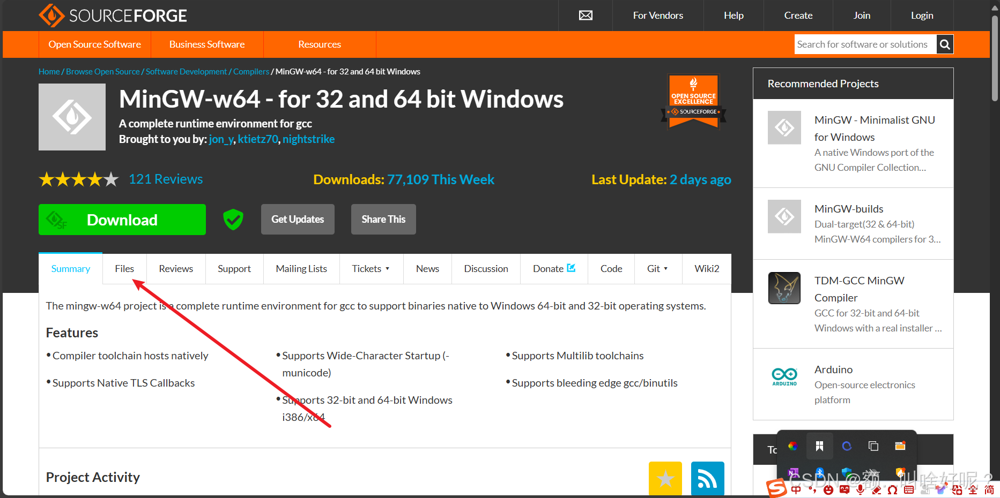
点"files"，然后往下翻

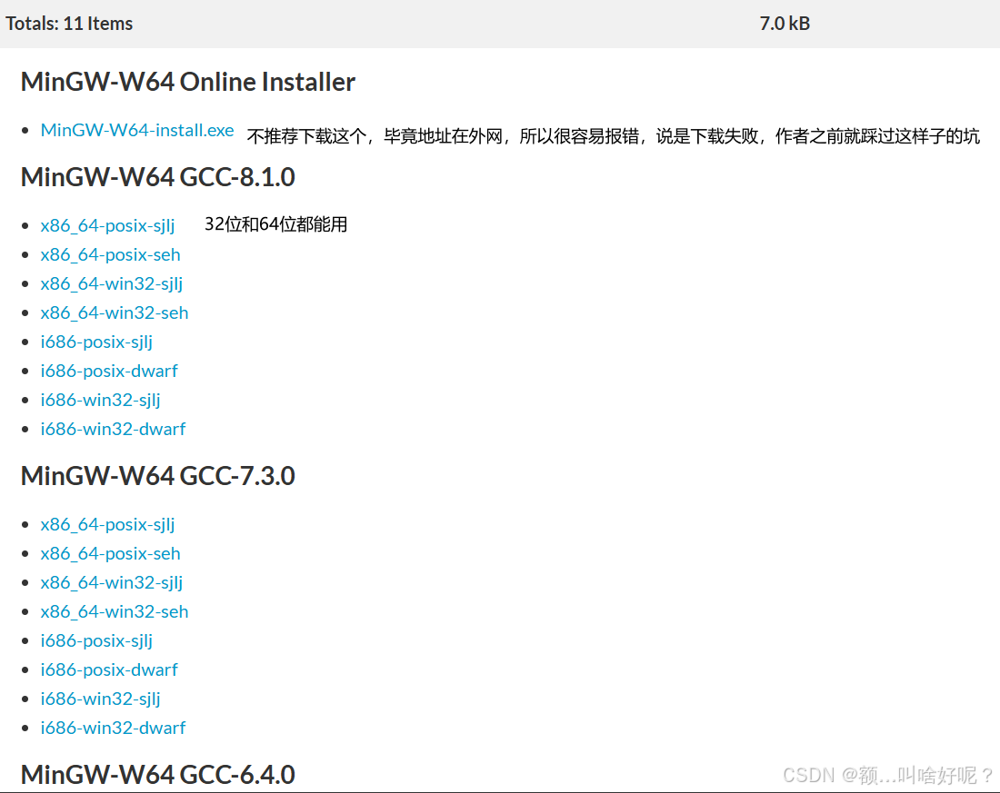
点推荐的那个，他会自动下载

然后选好路径解压，记得把路径弄得好记点(一会要用)，如果解压不了，可以看看[【WinRAR】WinRAR下载安装教程\_winrar下载csdn-CSDN博客](https://blog.csdn.net/weixin_44226181/article/details/130893421?ops_request_misc=%257B%2522request%255Fid%2522%253A%2522172256438716800186551192%2522%252C%2522scm%2522%253A%252220140713.130102334..%2522%257D&request_id=172256438716800186551192&biz_id=0&utm_medium=distribute.pc_search_result.none-task-blog-2~all~top_click~default-2-130893421-null-null.142%5Ev100%5Epc_search_result_base8&utm_term=winRAR%E4%B8%8B%E8%BD%BD&spm=1018.2226.3001.4187 "【WinRAR】WinRAR下载安装教程_winrar下载csdn-CSDN博客") 这篇文章

#### (二)、配置环境变量

按住 win(就那个窗户小图标) + i 打开设置，然后点 系统 > 系统信息

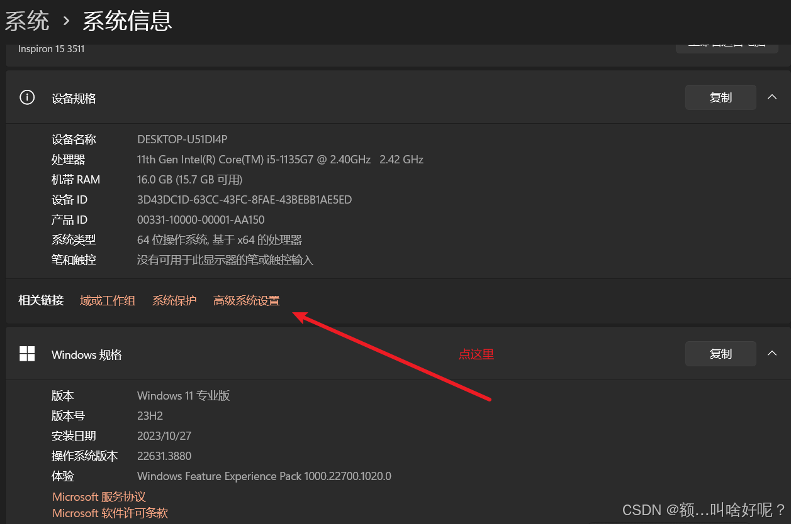
然后...

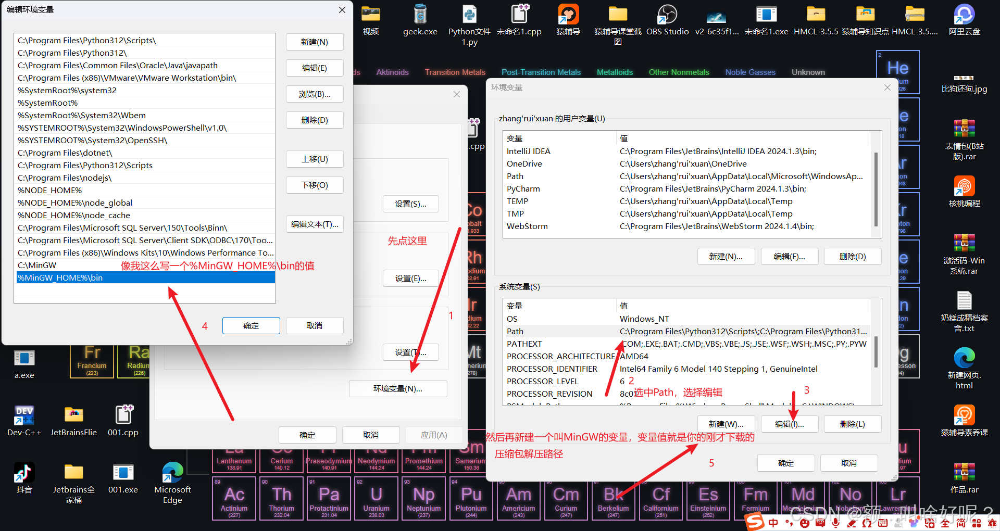
### 二、下载编译器

作者认为好用的C++编译器有这几款，安装...就那举二个例子吧(因为作者很懒，再加上之前好不容易装好的，舍不得删了)(点击底下的连接能切换到下载页面)

1.DEV C++[Dev-C++ download | SourceForge.net](https://sourceforge.net/projects/orwelldevcpp/ "Dev-C++ download | SourceForge.net")

 [Dev-C++ download | SourceForge.net](https://sourceforge.net/projects/orwelldevcpp/ "Dev-C++ download | SourceForge.net")

2.CLion

[下载 CLion：用于 C/C++ 开发的智能跨平台 IDE (jetbrains.com)](https://www.jetbrains.com/zh-cn/clion/download/#section=windows "下载 CLion：用于 C/C++ 开发的智能跨平台 IDE (jetbrains.com)")

3.Visual studio 2022(建议选Community版本的)

[Visual Studio 2022 IDE - 适用于软件开发人员的编程工具 (microsoft.com)](https://visualstudio.microsoft.com/zh-hans/vs/ "Visual Studio 2022 IDE - 适用于软件开发人员的编程工具 (microsoft.com)")

4.Visual studio Code

[Download Visual Studio Code - Mac, Linux, Windows](https://code.visualstudio.com/download "Download Visual Studio Code - Mac, Linux, Windows")

#### (一)、CLion下载

不多说废话，上链接[CLion：JetBrains 出品的 C 和 C++ 跨平台 IDE](https://www.jetbrains.com/zh-cn/clion/ "CLion：JetBrains 出品的 C 和 C++ 跨平台 IDE")

以下是纯图片教程

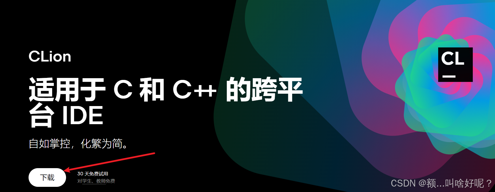
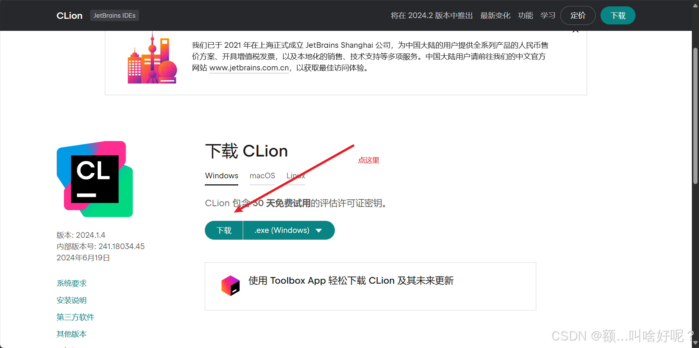
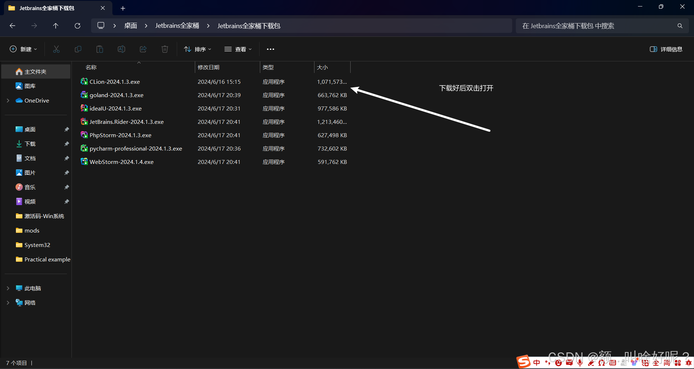
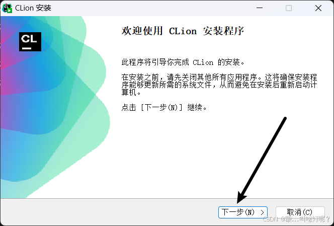
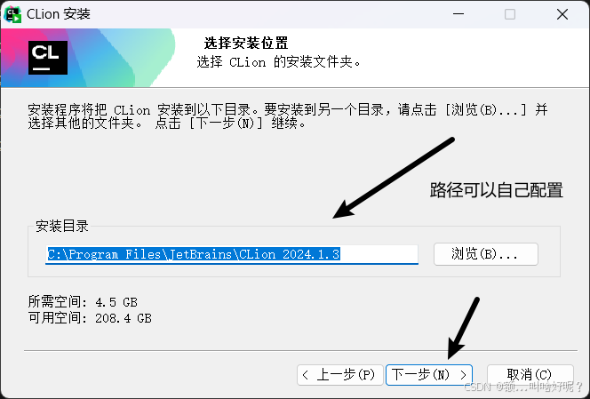
然后就都点确定，就可以开始安装了。
[https://oj.hetao101.com/file/102487/x99DWE7kH8EjikhxgfErf.zip](https://oj.hetao101.com/file/102487/x99DWE7kH8EjikhxgfErf.zip "https://oj.hetao101.com/file/102487/x99DWE7kH8EjikhxgfErf.zip")

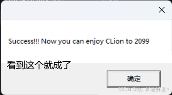
汉化就像我的[安装Pycharm以及调成汉化\_pycharm调成中文-CSDN博客](https://blog.csdn.net/2301_76378154/article/details/138761017?spm=1001.2014.3001.5501 "安装Pycharm以及调成汉化_pycharm调成中文-CSDN博客")这篇文章中的调整汉化一样，然后，恭喜你，CLion配置成功！

#### (二)、DEV-C++

DEV C++说是要配置，实际不用，只用下载就可以了

点上面的连接下载安装包

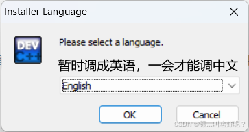
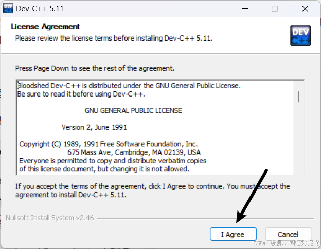
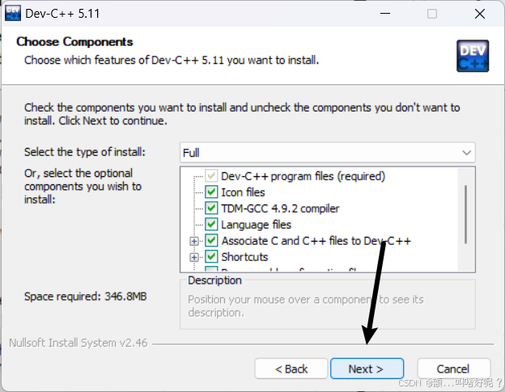
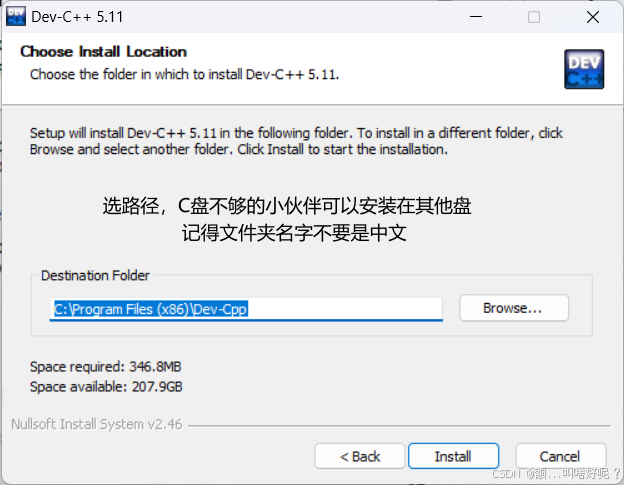
点Install

全部配置好后重启电脑即可生效。

​