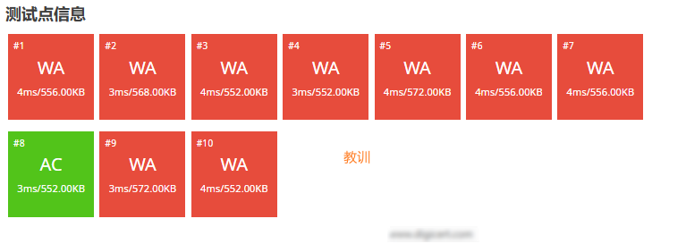
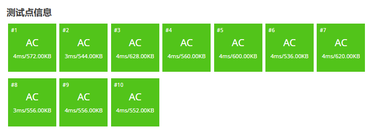

# 题目

### 题目描述

$N$ 进制数指的是逢 $N$ 进一的计数制。例如，人们日常生活中大多使用十进制计数，而计算机底层则一般使用二进制。除此之外，八进制和十六进制在一些场合也是常用的计数制（十六进制中，一般使用字母 A 至 F 表示十至十五；本题中，十一进制到十五进制也是类似的）。

在本题中，我们将给出 $N$ 个不同进制的数。你需要分别把它们转换成十进制数。

### 输入格式

输入的第一行为一个十进制表示的整数 $N$。接下来 $N$ 行，每行一个整数 $K$，随后是一个空格，紧接着是一个 $K$ 进制数，表示需要转换的数。保证所有 $K$ 进制数均由数字和大写字母组成，且不以 $0$ 开头。保证 $K$ 进制数合法。

保证 $N \le 1000$；保证 $2 \le K \le 16$。

保证所有 $K$ 进制数的位数不超过 $9$。

### 输出格式

输出 $N$ 行，每一个十进制数，表示对应 $K$ 进制数的十进制数值。

### 输入输出样例 #1

#### 输入 #1

```
2
8 1362
16 3F0
```

#### 输出 #1

```
754
1008
```

### 输入输出样例 #2

#### 输入 #2

```
2
2 11011
10 123456789
```

#### 输出 #2

```
27
123456789
```

### 说明/提示

对于任意一个 $L$ 位 $K$ 进制数，假设其最右边的数位为第 $0$ 位，最左边的数位为第 $L-1$ 位，我们只需要将其第 $i$ 位的数码乘以权值 $K^i$，再将每位的结果相加，即可得到原 $K$ 进制数对应的十进制数。下面是两个例子：

1. 八进制数 `1362` 对应的十进制数为：$1 \times 8^3 + 3 \times 8^2 + 6 \times 8^1 + 2 \times 8^0 = 754$；

2. 十六进制数 `3F0` 对应的十进制数为：$3 \times 16^2 + 15 \times 16^1 + 0 \times 16^0 = 1008$。

# 大意

就是利用学到的进制转换由笔算改为电脑处理（记得使用 `long long` 否则会 WA）

??? warning "教训"
    

## 代码

```cpp
#include <iostream>
#include <cstdio>
#include <cstring>
#include <algorithm>
#include <vector>
#include <map>
#include <set>
#include <cmath>
#include <queue>
#include <stack>
#include <string>
#include <bitset>
#include <iomanip>
#include <sstream>
#include <utility>
#include <functional>
#include <cassert>
#include <unordered_map>
#include <unordered_set>
#include <ctime>//不是故意搞这么多的(有意的)
using namespace std;
typedef long long ll;

ll N_base_to_DEC(ll base, string s) {
    ll ans = 0; 
    for (char c : s) {
        if (c >= '0' && c <= '9') {
            ans = ans * base + (c - '0');
        }
        else {
            ans = ans * base + (c - 'A' + 10);
        }
    }
    return ans;
}

int main() {
    ios::sync_with_stdio(false);
    cin.tie(nullptr);
    cout.tie(nullptr);
    ll N;
    cin >> N;
    while (N--) {
        ll base;
        string s;
        cin >> base >> s;
        ll num = N_base_to_DEC(base, s);
        cout << num << endl;
    }
    return 0;
}
```


胜利！(AC)
